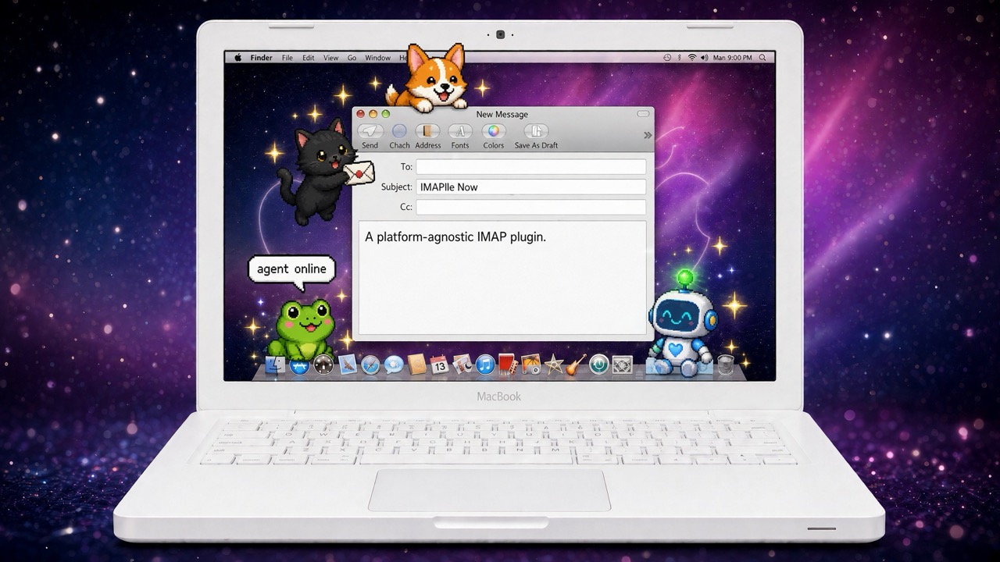

# IMAPlle Now

> A platform-agnostic IMAP plugin. Portable setup guidance + bounded connection checks any agent platform can adapt.



Canonical package ID: `apple-and-icloud-mail` (directory + manifest `name`, unchanged). Display name **IMAPlle Now** uses the single-P spelling on purpose — no Apple affiliation, endorsement, or full Apple-service coverage implied. Calendar, Contacts, Drive, Photos, Keychain, and Apple Mail automation are outside scope.

## What it is

Skills-only, MIT-licensed guidance for IMAP setup and exact-folder connection checks. No runtime, account, server, credential store, hook, watcher, MCP config, or executable mail helper is bundled. Himalaya and GigaMail remain separately installed dependencies on the host doing the work.

One skill, four capabilities:

1. IMAP setup guidance and staged connection checks (`authentication verified` → `exact-folder headers verified` → `scoped body read verified`).
2. Exact-folder bridge selection, with a configured Himalaya fallback.
3. Per-user account and credential instructions.
4. Explicit Mac-required / configured-host / remote-capable route labels.

Read [the skill](skills/icloud-mail-setup/SKILL.md) for the workflow. References: [accounts](skills/icloud-mail-setup/references/accounts.md) · [platforms](skills/icloud-mail-setup/references/platforms.md) · [transports](skills/icloud-mail-setup/references/transports.md) · [proof-checks](skills/icloud-mail-setup/references/proof-checks.md).

## Insurance, not overcoverage

Two lanes, same app-specific password: Himalaya (proven first, zero provisioning) + GigaMail scoped reader (rollback when one chokes). Same secret, same fate — different tool failure modes. Fallback never repairs a shared invalid credential; it covers tools, not trust.

## Credentials: one copy, purge the rest

- The human hand-places one app-specific password in their own `.env` as `APPLE_IMAP_PWD`. Agents verify *around* it — the value never enters model context, logs, or reports.
- Live reads resolve that one var at call time (same pattern as Himalaya's `password.command`). No second copy in a bridge store, no symlink at the whole `.env`.
- Any bridge provisioning is transient: after the approved read, remove the provisioned secret and temp artifacts, verify back to one copy, report the cleanup. Retention as a working credential needs its own documented exception.
- Why: even a harmless leftover in a shared folder confuses multi-agent hosts, shadowing rotation with stale creds.

## Try it without authenticating

```text
Use IMAPlle Now to review my IMAP setup without authenticating.
```

Offline inventory, manifest/skill validation, and link checks run with no mail access. Publishing honest docs needs no authentication; any live mail proof needs its own concrete authorization (exact host, account, folder, selection, route).

## Provenance

Banner: grand-reveal art, operator-nominated (see [assets/PROVENANCE.md](assets/PROVENANCE.md)). Original retained as canopy; crops are center-crops. Earlier smoke candidates live outside this package. Subject line in art reads `IMAPIle Now` in pixel font — adopted public spelling `IMAPlle Now`.

## Install / rollback

After review + separate authorization: copy this folder into a plugin directory, add one marketplace entry pointing at it ([OpenAI packaging](https://developers.openai.com/plugins/build/plugins)), test discovery in a fresh chat. Rollback = remove that entry + folder only. No accounts touched, no passwords revoked. Catalog submissions (Claude, Hermes, others) are tracked as next steps — this tree is the portable source they all adapt from.

## License

MIT — see [LICENSE](LICENSE) (Thomas Kenny / mooserini) + [NOTICE.md](NOTICE.md) (retained hermes-openwhispr MIT notice for adapted docs).
